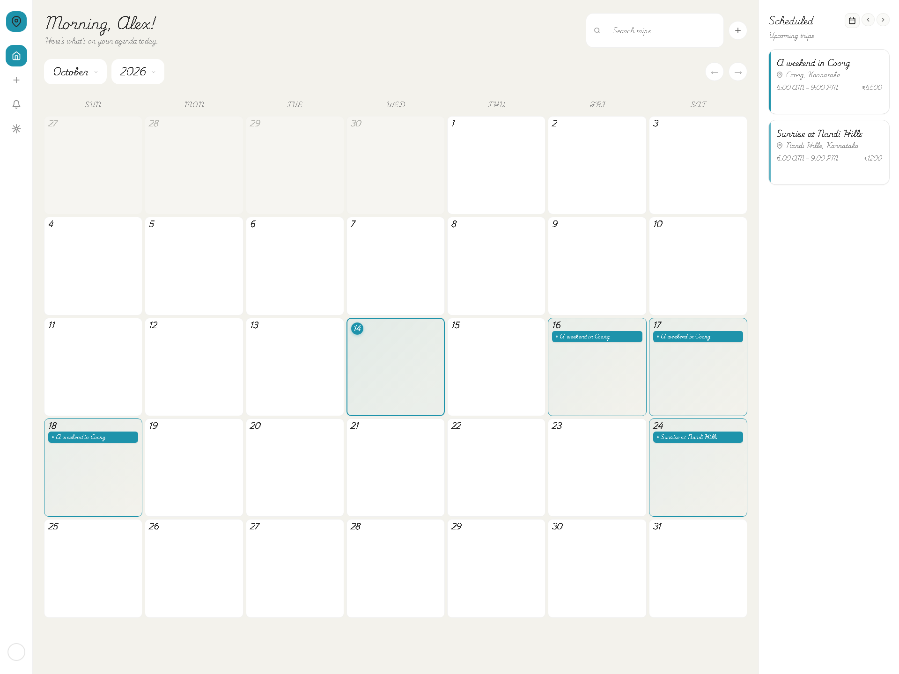
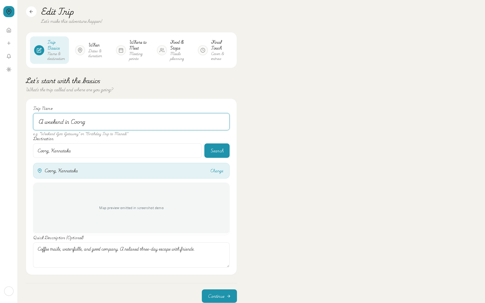
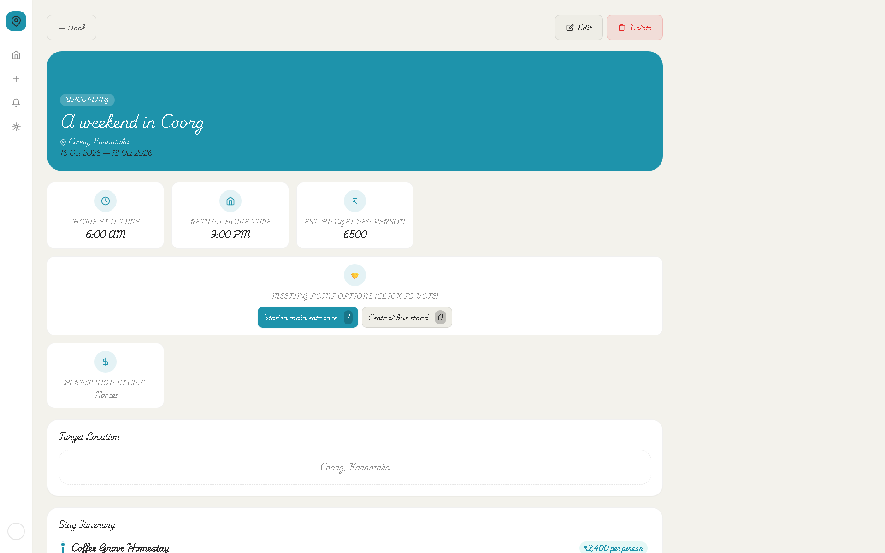
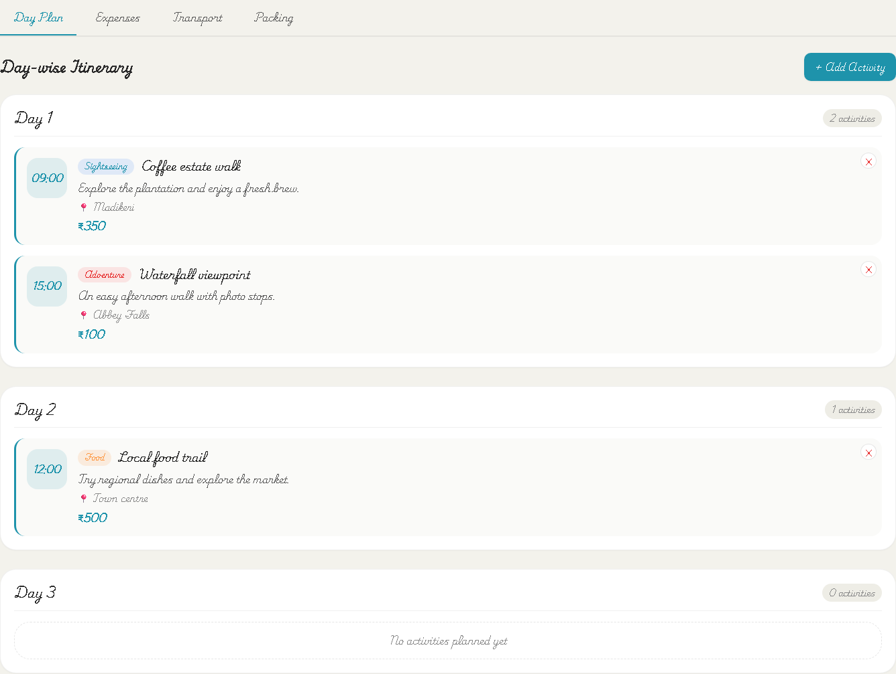
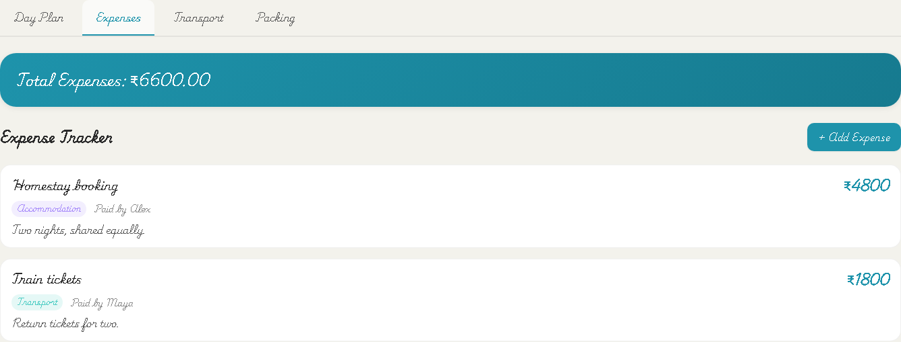

# Trip Planner

A React app for planning day trips and multi-day adventures with friends: pick dates, coordinate meeting points, plan activities, and keep travel details together.

The repository name is **trip-planner**. The interface retains its original **That One Day** branding.



> **Project status:** portfolio/demo application. The current custom login stores plain-text passwords and relies on browser-side access checks. Use fictional data in an isolated development project. Read [security and limitations](docs/SECURITY.md) before connecting a backend or deploying publicly.

## Features

- **Calendar dashboard:** browse trips by date, search titles and destinations, and see upcoming plans.
- **Five-step trip wizard:** trip basics, dates and duration, meeting points, food stops, and final details including cover images and budget.
- **Group coordination:** add members, vote on meeting points, record transport modes and carpool choices, and discuss plans in comments.
- **Multi-day planning:** day-by-day activities, expense entries with payer and split participants, transport bookings, and personal/shared packing checklists. These tabs appear when a trip lasts more than one day.
- **Trip information:** destination maps, meal times and places, accommodations, photo uploads, and shared external links.
- **Accounts and administration:** registration awaiting approval, profile settings and avatars, user approval/roles, and trip administration.

Expenses display a total in Indian rupees; the app does not calculate net balances, automate payments, or provide a settlement workflow.

## Screenshots

These are captures of the actual React interface using fictional, intercepted API responses. They do not show private accounts or prove live backend connectivity. See [all eight screenshots and capture instructions](docs/SCREENSHOTS.md).

| Trip wizard | Trip overview |
| --- | --- |
|  |  |

| Day plan | Expenses |
| --- | --- |
|  |  |

## Tech stack

| Layer | Technology |
| --- | --- |
| Interface | React 18, CSS |
| Build tooling | Vite 4, npm, ESLint 8 |
| Routing | React Router 7 |
| Data and media | Supabase JavaScript client, PostgreSQL, Supabase Storage |
| Location search | OpenStreetMap Nominatim; Google Maps embeds/link parsing |
| Optional analytics and hosting | Firebase Analytics, Firebase Hosting |
| Documentation screenshots | Playwright Chromium |

Leaflet packages are installed, but the current pages use Google Maps iframe previews rather than a Leaflet map component.

## Quick start

Use Node.js 22 or newer and npm. Validation for this documentation used Node.js 24.14.1.

```bash
git clone https://github.com/Sanju2911/trip-planner.git
cd trip-planner
npm ci
```

Copy `.env.example` to `.env` and supply your own Supabase project URL and anonymous browser key:

```dotenv
VITE_SUPABASE_URL=https://your-project.supabase.co
VITE_SUPABASE_ANON_KEY=your-supabase-anon-key
```

Follow [the setup guide](docs/SETUP.md) to initialize a **fresh disposable demo database** and approve your first account. Firebase Analytics is optional; leaving its environment fields blank disables initialization.

```bash
npm run dev
```

Open the local URL printed by Vite, usually `http://localhost:5173`.

## Commands

| Command | Purpose |
| --- | --- |
| `npm run dev` | Start the development server |
| `npm run build` | Build production assets into `dist/` |
| `npm run preview` | Preview a local production build |
| `npm run lint` | Check JavaScript and JSX with ESLint |
| `npm run docs:screenshots` | Capture screenshots against a running local server |

## Project layout

```text
src/
  pages/          Account, dashboard, trip, profile, and admin screens
  components/     Sidebar navigation, loaders, multi-day planning tabs
  context/        Custom login, toast messages, notifications
  lib/            Supabase client and optional Firebase initialization
database/
  demo-schema.sql Fresh demo schema matching the current client
docs/
  screenshots/    Committed PNG screenshots
scripts/
  capture-screenshots.mjs
```

## Documentation

- [Setup, database initialization, and hosting](docs/SETUP.md)
- [Architecture, routes, and data model](docs/ARCHITECTURE.md)
- [Screenshot gallery and reproduction](docs/SCREENSHOTS.md)
- [Security limitations and known gaps](docs/SECURITY.md)
- [GitHub publication checklist](docs/GITHUB.md)

## Validation

The production build, ESLint checks, and screenshot capture were verified locally on 14 October 2026. Vite reports a bundle-size warning for a JavaScript chunk larger than 500 kB. The new demo SQL has been reviewed against the frontend queries but has not been executed against a Supabase project; live database, storage, and external map workflows remain unverified.

## Contributing and license

Use focused changes and run `npm run lint` and `npm run build` before opening a pull request. Never commit local credentials, database exports, or screenshots of real user data.

No license has been selected. Add an appropriate `LICENSE` file before offering the project for reuse; public visibility alone does not grant reuse permission.

