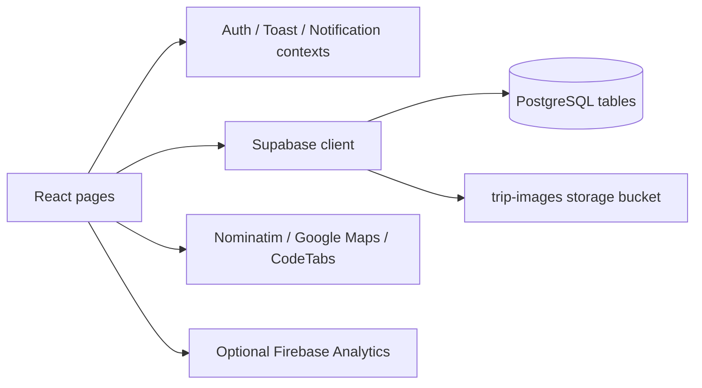

# Architecture

## Application flow

`src/main.jsx` creates the React root, imports global CSS and optional Firebase initialization, and wraps the app in `AuthProvider`, `ToastProvider`, and `NotificationProvider`. `src/App.jsx` supplies browser routing and route guards.

The application accesses Supabase directly from the browser. There is no application server in this repository.

## Routes

| Route | Screen | Browser guard |
| --- | --- | --- |
| `/auth` | Sign in / registration | Redirects signed-in users home |
| `/` | Calendar and upcoming trips | Custom session required |
| `/trips/new` | Five-step creation wizard | Custom session required |
| `/trips/:id` | Trip overview and collaboration | Custom session required |
| `/trips/:id/edit` | Trip editing wizard | Custom session required |
| `/profile` | Account settings and avatar | Custom session required |
| `/admin` | User approval, roles, user creation, trip management | Custom session and profile role check |
| Other paths | Not-found screen | None |

These guards control navigation. They do not enforce database authorization or trip ownership. The admin guard also allows rendering if the user exists but the profile is absent; a production guard should require a confirmed admin profile.

## State and authentication

`AuthContext` loads `trip_planner_user` from local storage, fetches the corresponding profile, and rejects unapproved accounts. Login queries `profiles` by email and password and stores only `{ id, email }` as the local session. There is no Supabase Auth token, verified server-side session, or password hashing.

Each page maintains its own form/loading state. Toasts provide feedback. The notification context retains up to 50 in-memory notifications, exposes permission handling, and can create browser notifications. The current pages do not call its `sendNotification` method; trip reminders and automated change notifications are not implemented.

## Data model used by the frontend

| Table | Purpose |
| --- | --- |
| `profiles` | Account data, password, role, approval, avatar, display-name lock |
| `trips` | Trip title, creator, dates, destination, meals, budget, meeting options, accommodations |
| `trip_members` | Membership, transport modes, carpool choice |
| `trip_images` | Image storage paths, public URLs, uploader |
| `trip_meeting_votes` | One meeting-point vote per member and trip |
| `trip_comments` | Discussion messages linked to profiles |
| `trip_links` | Shared links and titles |
| `trip_itinerary` | Activities grouped by day, time, category, location, estimated cost |
| `trip_expenses` | Expense title, amount, category, payer, split participant IDs |
| `trip_transport` | Transport type, booking details, departure/arrival, pickup, price |
| `trip_packing` | Personal/shared items and checked state |

Trips relate to their creator and have child rows linked by `trip_id`. Accommodations are a JSON array on `trips`. Expense participant IDs are stored in a UUID array. The current UI relies on PostgREST relationship expansion and explicitly names `trip_members_trip_id_fkey` and `trip_members_user_id_custom_fkey`; preserve these names when changing the schema.

The earlier multi-day SQL also defines groups, emergency contacts, and weather conditions. There are no current UI tabs or queries for those tables, so they are not included in the fresh demo schema or advertised as implemented features.

## Important modules

- `HomePage.jsx`: loads trips the current user created or joined; filters them locally and renders calendar and agenda views.
- `TripFormPage.jsx`: five-step creation/editing, place resolution, upload handling, and trip/member insertion.
- `TripDetailPage.jsx`: loads trip, members, photos, votes, comments, and links concurrently; manages subsequent section updates.
- `TripTabs.jsx`: independent itinerary, expenses, transport, and packing components. Rendered only for `total_days > 1`.
- `AdminPage.jsx`: approves users, changes roles, creates users, and manages trips.
- `ProfilePage.jsx`: avatar upload, username/password editing, and a one-time display-name change enforced by client state.
- `src/lib/supabase.js`: creates the shared browser client from environment variables.
- `src/lib/firebase.js`: conditionally initializes Firebase and analytics when configuration is supplied.

Data refreshes follow page loads and local mutations. There are no realtime subscriptions, service workers, background reminders, or offline persistence for trips.
