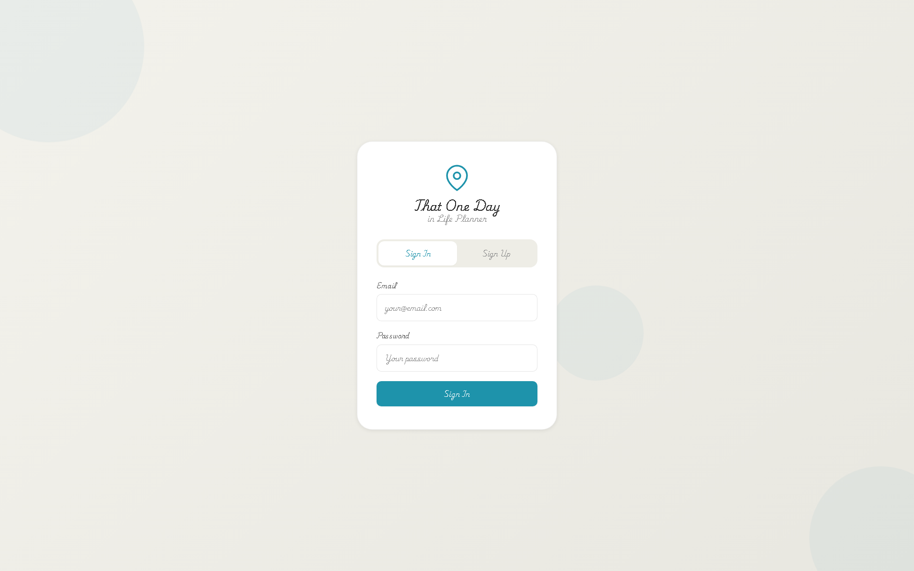
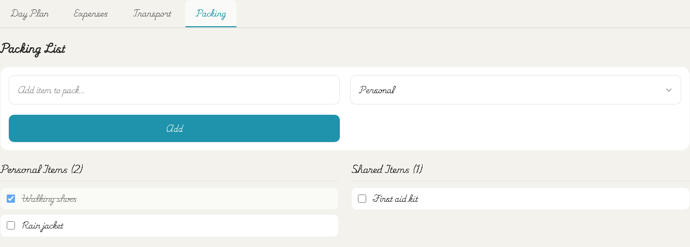
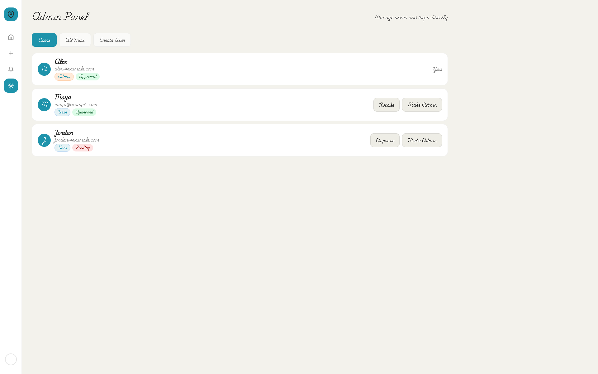

# Screenshot gallery

Captured on 14 October 2026 using Playwright Chromium against the actual local React application. Desktop viewport: **1920 × 1200**, with **1920 × 1440** for the dashboard to show the entire calendar. Planning tabs are cropped to their component boundaries; other images show the viewport. The browser clock is fixed to 14 October 2026 in Asia/Kolkata for repeatable calendar content.

All names, emails, trips, expenses, and messages are fictional. Supabase REST requests, including effect-triggered updates, are intercepted. No remote database is contacted. Remote services are blocked except Google Fonts; map embeds display an explicit demo placeholder. Trip overview coordinates are omitted. These are UI illustrations, not evidence of end-to-end backend validation.

## Sign in



## Calendar dashboard


## Five-step trip wizard

The populated edit screen shows the same wizard used for trip creation.


## Trip overview


## Day-by-day itinerary


## Expenses


## Packing checklist



## Admin dashboard



## Reproduce the captures

Install project dependencies and the Playwright browser:

```bash
npm ci
npx playwright install chromium
```

Copy `.env.example` to `.env`. For screenshots only, its example URL/key strings can remain: the Supabase client requires configuration to initialize, but requests are intercepted before navigation. A live database and schema installation are unnecessary for this capture workflow. Leave Firebase fields blank.

Start Vite in one terminal:

```bash
npm run dev -- --host 127.0.0.1
```

In a second terminal:

```bash
npm run docs:screenshots
```

The script overwrites the eight PNGs in `docs/screenshots/`. If Vite uses a different port, set `SCREENSHOT_BASE_URL`:

```powershell
$env:SCREENSHOT_BASE_URL = 'http://127.0.0.1:5174'
npm run docs:screenshots
```

Fixture data is in `scripts/capture-screenshots.mjs`. Keep it fictional. Screenshots preserve current UI styling, including the handwritten font and original branding.
